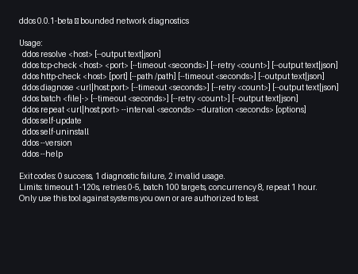

# ddos

<p align="center">
  <picture>
    <source media="(prefers-color-scheme: dark)" srcset="ddos-logos/logo-on-dark-mode.svg">
    <source media="(prefers-color-scheme: light)" srcset="ddos-logos/logo-on-light-mode.svg">
    
  </picture>
  <h1 align="center">ddos</h1>
  <p align="center">Bounded network diagnostics for systems you own or are authorized to test.</p>
</p>

<p align="center">
  <a href="https://github.com/rkriad585/ddos/actions/workflows/release.yml"></a>
  <a href="https://github.com/rkriad585/ddos/actions/workflows/docs.yml"></a>
  
  
  <a href="https://github.com/rkriad585/ddos/blob/main/LICENSE"></a>
  <a href="https://github.com/rkriad585"></a>
</p>

`ddos` is a Rust command-line tool for bounded DNS, TCP, HTTP, and HTTPS
diagnostics. It deliberately avoids flooding, spoofing, evasion, and
unbounded traffic generation.

## Screenshot

<p align="center">
  
</p>

<p align="center">
  <em>Real output from <code>ddos --help</code>. More details are available in
  <a href="docs/screenshots.md">the screenshot documentation</a>.</em>
</p>

The image is generated from the current CLI by
[`tools/screenshots_gen.py`](tools/screenshots_gen.py) using Pillow, so it stays
aligned with the implemented commands.

## Table of contents

- [Key features](#key-features)
- [Installation](#installation)
- [Quick start](#quick-start)
- [Usage examples](#usage-examples)
- [Documentation](#documentation)
- [Interface](#interface)
- [Architecture](#architecture)
- [Requirements](#requirements)
- [Prerequisites](#prerequisites)
- [Development](#development)
- [Contributing](#contributing)
- [Security](#security)
- [License](#license)

## Key features

- DNS resolution through the operating system resolver, with IPv4/IPv6
  selection.
- One bounded TCP connection check with a configurable 1–120 second timeout.
- One HTTP `HEAD`/`GET` request with custom headers, Basic/Bearer auth,
  user-agent override, and an optional bounded body read (max 1 MiB).
- Unified HTTPS/TLS diagnostics with bounded redirects, validated
  certificates, and certificate metadata (subject, issuer, serial, SANs,
  expiry, negotiated protocol, and cipher suite).
- Standalone `tls-check` for certificate metadata without an HTTP report.
- `--audit-headers` reports common HTTP security headers with a weighted
  0–100 score and A–F grade for quick defensive review.
- `ddos report <url|host:port>` generates a Markdown assessment report with
  DNS/TCP/HTTP/TLS results, security-header findings, and a security grade.
- Bounded TCP `port-scan` with CSV/range specs, concurrency limits, and an
  explicit scope requirement for non-loopback targets.
- `path-discovery` with a built-in wordlist or custom `--wordlist`, reporting
  interesting status codes without following redirects.
- `cors-check` and `cookie-check` for CORS misconfigurations and cookie flag
  problems, including `__Host-`/`__Secure-` prefix validation.
- `method-check` audits `OPTIONS`/`HEAD`/`TRACE`, the `Allow` header, advertised
  state-changing methods, and cross-site tracing without sending unsafe verbs.
- `--expect-status` now works for 4xx and 5xx responses, including bounded
  body previews.
- Authorization scope files (`--scope`) restrict every network target to an
  explicit host, wildcard domain, IP, or CIDR allowlist.
- JSONL audit logs (`--audit-log`) record command, target, status, and exit
  code without logging credentials.
- Bounded UDP probe checks with configurable payloads.
- Built-in DNS record lookups (`A`, `AAAA`, `CNAME`, `TXT`, `MX`, `NS`).
- JSON, JSON Lines, CSV, and text output; bounded retries; batch checks; and
  repeat monitoring.
- Consent-gated load testing with hard loopback, rate (50 req/s), and volume
  (5000 requests) caps, plus rotating or randomized realistic browser
  user-agent selection.
- Built-in `user-agents` command to inspect the browser agent pool.
- Layered configuration: CLI args > `DDOS_*` env vars >
  `~/.config/ddos/config.toml`, with `config path` and `config init` helpers.
- Certificate status checks, expected-status checks, selected response
  headers, redirect limits, proxy support, and embedded shell completions.
- `--quiet` for exit-code-only text runs and `--no-color` for compatibility
  with plain-text pipelines.
- Self-update through the official platform installer.
- Self-uninstall of the current executable.
- Release binaries for Linux, Windows, macOS, Android/Termux, and Nix.

## Installation

Windows PowerShell:

```powershell
irm https://raw.githubusercontent.com/rkriad585/ddos/main/installer.ps1 | iex
```

Linux, macOS, and Termux:

```sh
curl -fsSL https://raw.githubusercontent.com/rkriad585/ddos/main/installer.sh | sh
```

Cargo:

```sh
cargo install --git https://github.com/rkriad585/ddos.git
```

Release installers use `~/.config/peekstore/ddos/` on Unix-like systems and
`%USERPROFILE%\\.config\\peekstore\\ddos\\` on Windows.

## Quick start

```sh
ddos resolve localhost
ddos tcp-check example.com 443 --timeout 5
ddos http-check example.com --path / --timeout 5
ddos diagnose https://example.com --output json
```

## Usage examples

```text
ddos 0.0.2-beta — bounded network diagnostics

Usage:
  ddos resolve <host> [options]
  ddos tcp-check <host> <port> [--timeout <seconds>] [--retry <count>] [options]
  ddos http-check <host> [port] [--path /path] [--method HEAD|GET] [options]
  ddos diagnose <url|host:port> [--method HEAD|GET] [--expect-status <code>] [options]
  ddos report <url|host:port> [options]
  ddos udp-check <host> <port> [--payload <hex>] [--retry <count>] [options]
  ddos dns-check <host> [--dns-type <type>] [--dns-server <ip>] [options]
  ddos tls-check <host> [port] [options]
  ddos user-agents [--output text|json|jsonl|csv]
  ddos batch <file|-> [--timeout <seconds>] [--retry <count>] [options]
  ddos repeat <url|host:port> --interval <seconds> --duration <seconds> [options]
  ddos load-test <url|host:port> [--rate <req/s>] [--count <requests>] [options]
  ddos port-scan <host> [--ports <spec>] [--concurrency <n>] [options]
  ddos path-discovery <url|host:port> [--wordlist <file>] [options]
  ddos cors-check <url|host:port> [--origin <origin>] [options]
  ddos cookie-check <url|host:port> [options]
  ddos method-check <url|host:port> [options]
  ddos completion <bash|zsh|fish|powershell|nushell>
  ddos config <path|init>
  ddos self-update
  ddos self-uninstall
  ddos --version
  ddos --help
```

Example scripted diagnostics:

```sh
ddos diagnose https://api.example.com --auth bearer "$TOKEN" --show-header server
ddos dns-check example.com --dns-type TXT --output json | jq '.answers'
ddos udp-check 1.1.1.1 53 --timeout 3 --output jsonl
ddos tls-check example.com 443 --output json
ddos user-agents --output csv
ddos report https://example.com > assessment.md
ddos port-scan 127.0.0.1 --ports 3030,3043,8080 --output json
ddos path-discovery http://127.0.0.1:3030 --output json
ddos cors-check http://127.0.0.1:3030/api/users --output json
ddos cookie-check http://127.0.0.1:3030/api/login --output json
ddos method-check http://127.0.0.1:3030/api/users --output json
```

Sample output from a healthy HTTPS target:

```text
$ ddos diagnose https://example.com --show-header server --show-header content-type
OK https://example.com (663 ms)
DNS: 4 address(es)
  ipv4 172.66.147.243:443 open (34 ms)
  ipv4 104.20.23.154:443 open (41 ms)
HTTP: 200 OK
  server: cloudflare
  content-type: text/html; charset=utf-8
TLS: CN=example.com -> C=US, O=SSL Corporation, CN=Cloudflare TLS Issuing ECC CA 3 (expires Dec 25 22:56:35 2026 +00:00) serial 01:ee:e6:aa:bb:52:1d:5e:14:fc:31:5f:d9:98:56:90
  SANs: example.com, *.example.com
  TLS protocol: TLSv1_3
  cipher suite: TLS13_AES_256_GCM_SHA384
```

Authorized-assessment workflow with an explicit scope and audit trail:

```sh
cat > scope.txt <<'EOF'
# Only these targets are authorized for this engagement.
client.example
*.client.example
192.0.2.0/24
EOF

ddos diagnose https://client.example --scope scope.txt --audit-log engagement.jsonl
ddos http-check client.example --scope scope.txt --audit-headers
ddos tls-check client.example --scope scope.txt --output json
ddos report https://client.example --scope scope.txt > assessment.md
ddos port-scan client.example --ports 1-1000 --scope scope.txt
ddos path-discovery https://client.example --scope scope.txt --output json
ddos cors-check https://client.example/api --scope scope.txt
ddos cookie-check https://client.example/login --scope scope.txt
ddos method-check https://client.example/api --scope scope.txt
```

`--scope` fails closed: any target outside the file returns exit code 2 before
the diagnostic runs. Scope entries are exact hosts, `*.domain` subdomains,
IP addresses, or CIDR ranges; `#` starts a comment. When a scope file is
active, HTTP redirects are not followed so a redirect cannot leave the
authorized scope.

Loopback load testing against a local dev server (loopback targets only):

```text
$ ddos load-test http://localhost:3030 --rate 50 --count 200 --rotate-user-agent --method GET
LOAD-TEST http://localhost:3030 sent 200 ok 200 failed 0 (4071 ms total, 49.1 req/s actual, target 50 req/s)
  statuses: 200x200
  latency min 1 ms avg 3 ms max 47 ms (user agents rotated)
```

Maintenance commands:

```sh
ddos self-update
ddos --selfuninstall
```

Shell and configuration helpers:

```sh
ddos completion bash > ~/.local/share/bash-completion/completions/ddos
ddos config path
ddos config init
```

The installer-based uninstall command also removes the managed PATH entries:

```sh
curl -fsSL https://raw.githubusercontent.com/rkriad585/ddos/main/installer.sh | sh -s -- --selfuninstall
```

## Documentation

| Topic | Document |
| --- | --- |
| Home | [docs/index.md](docs/index.md) |
| Getting started | [docs/getting-started.md](docs/getting-started.md) |
| Installation | [docs/installation.md](docs/installation.md) |
| CLI | [docs/cli.md](docs/cli.md) |
| Architecture | [docs/architecture.md](docs/architecture.md) |
| Configuration | [docs/configuration.md](docs/configuration.md) |
| Development | [docs/development.md](docs/development.md) |
| Deployment | [docs/deployment.md](docs/deployment.md) |
| FAQ | [docs/faq.md](docs/faq.md) |
| Screenshots | [docs/screenshots.md](docs/screenshots.md) |
| Troubleshooting | [docs/troubleshooting.md](docs/troubleshooting.md) |

## Interface

The interface is a command-line binary named `ddos`. It writes human-readable
results to standard output, errors to standard error, and returns a nonzero
exit status for invalid input or failed checks. See the [CLI reference](docs/cli.md).

## Architecture

```text
src/main.rs
├── argument dispatch and layered options (CLI > env > config file)
├── DNS resolution (ToSocketAddrs)
├── TCP checks (TcpStream)
├── HTTP HEAD/GET checks (TcpStream)
├── UDP probes (UdpSocket)
├── minimal DNS-over-UDP record lookups
├── TLS certificate inspection
└── installer maintenance commands
```

DNS and TCP checks use the Rust standard library. HTTP and HTTPS diagnostics
use the Rustls-backed `ureq` client with certificate validation.

## Requirements

- Rust edition 2021 and Cargo for source builds.
- `curl`, `sha256sum`, and a POSIX shell for `installer.sh`.
- PowerShell for `installer.ps1`.
- Docker for container builds.
- Python and MkDocs for documentation builds.

## Prerequisites

No application configuration or environment variables are required. Network
checks require DNS and socket access to the target system, with authorization
from its owner.

## Development

```sh
git clone https://github.com/rkriad585/ddos.git
cd ddos
cargo fmt --all -- --check
cargo test --all-targets
cargo clippy --all-targets --all-features -- -D warnings
```

Build a release binary with `cargo build --locked --release`. Build the docs
with `python3 -m pip install -r requirements-docs.txt && mkdocs build --strict`.

## Contributing

See [CONTRIBUTING.md](CONTRIBUTING.md).

## Security

See [SECURITY.md](SECURITY.md). Use this software only for authorized
diagnostics. Prefer `--scope` to enforce an explicit target allowlist and
`--audit-log` to keep a per-run engagement trail.

## License

This project is distributed under the [GNU GPL v3.0](LICENSE).
